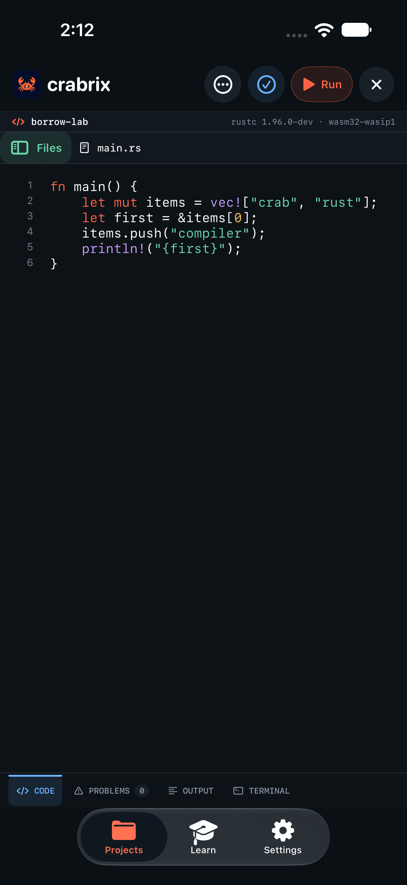
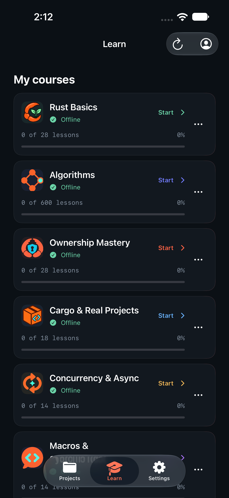
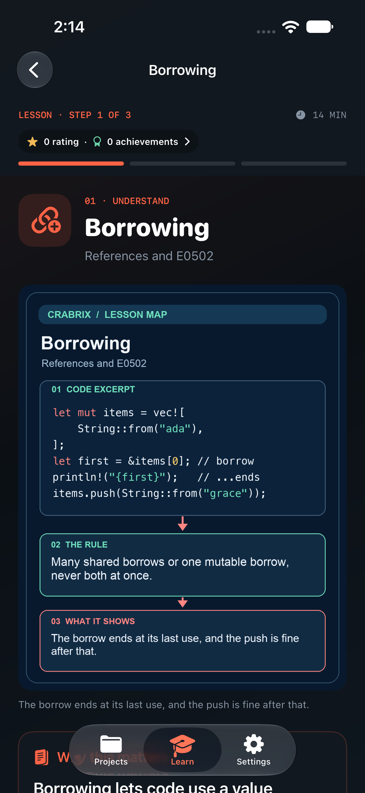
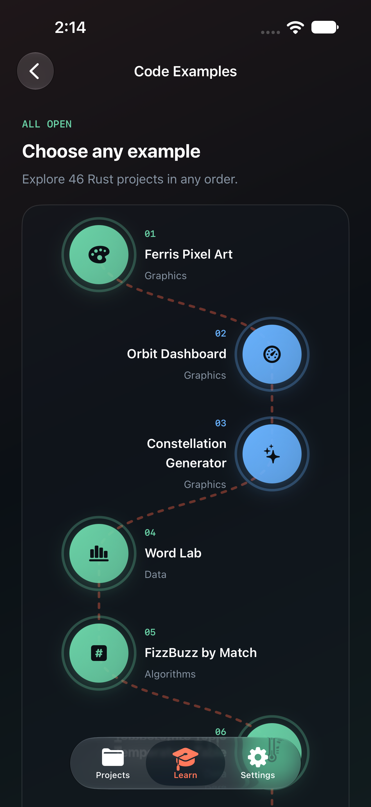
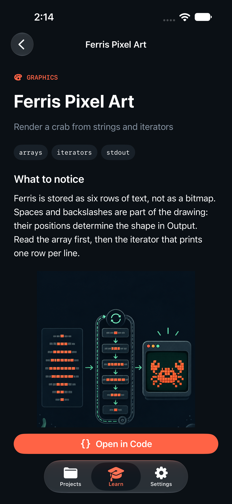
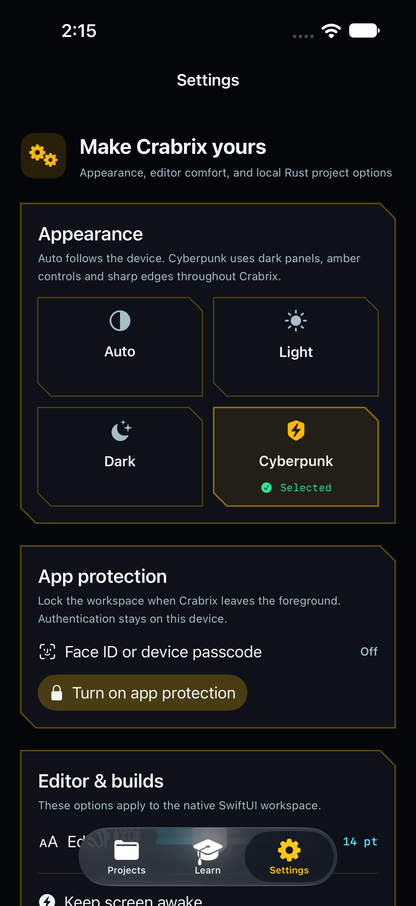

# Crabrix

**Learn Rust, then make it run.** Crabrix brings the full Academy and a real project workspace to iPhone and iPad. Follow a lesson, turn its source into your own project, see actual compiler diagnostics, and run Rust locally. Cargo support and the compiler live in the app; no account or cloud compiler is required.

[Website](https://crabrix.com) · [Next.js site and free Learn source](site/README.md) · [Support](https://crabrix.com/support/) · [Privacy](https://crabrix.com/privacy/) · [Changelog](CHANGELOG.md) · [Terms](https://crabrix.com/terms/) · [License library](https://crabrix.com/licenses/) · [App source license](LICENSE) · [Content rights](CONTENT-LICENSE.md)

## Shared source integrity — TestFlight 1.1.3 (119)

Incoming Shared edits preserve unshared local configuration and prepared source
files. Room deletions still apply; an invalid combined file budget disconnects
without replacing the current project. Native GitHub/Gist/Rust Playground origin
metadata no longer depends on a browser URL global. The fresh phone/iPad Simulator
matrix passed **26/26**, with store reopen and editable export covered.
Signed **119** is **VALID / IN_BETA_TESTING**, selected for App Review
(**WAITING_FOR_REVIEW**, manual publication). It retains TypeScript, preflight,
Rust symbols, Git, Atlas, tests, formatting and Debug from 118. The public guide,
capabilities and equal-height MCP setup cards are updated and checked at six
viewport/theme combinations. [Delivery receipt](docs/app-store/release-1.1.3-build119.json).
The published MCP bridge remains **0.1.1**, with eight source/selection tools.
Its future signed runtime protocol has a separate candidate qualification;
remote MCP Check/Run/Debug and permission UI are still unwired.

## Local Rust symbols — TestFlight 1.1.3 (116)

An import-free rust-analyzer Wasm Worker provides actual definitions,
project references, types/signatures, receiver-aware completion, import previews
and scoped rename. Reviewed edits require the unchanged workspace revision and
support whole-tree Undo. Analysis uses bundled standard-library text and
already prepared dependency sources, with explicit bounds and Stop; it does
not execute project code or use a backend. The final phone/iPad Simulator matrix
passed 68 tests with no failures or skips, including UI and keyboard/Debug
regressions. Signed build **116** is **VALID / IN_BETA_TESTING**; App Review
selection is tracked in the [delivery receipt](docs/app-store/release-1.1.3-build116.json).
[Profile](docs/semantic-ide-2026-10-29.md) · [qualification](docs/semantic-ide-qualification-2026-10-29.json).

## Offline TypeScript and project preflight — TestFlight 1.1.3 (118)

The original bundled TypeScript **5.9.3** checker uses 100 ES/DOM libraries and
prepared dependency declarations in a disposable local WebKit Worker. Check and
`npm run check` / `npm run typecheck` report actual types and source positions;
Run independently transpiles/bundles. Explicit npm preparation retains declared
`@types`, their dependency declarations and original licenses. Check/Run never
fetch missing packages or types and do not execute arbitrary npm scripts.

Files preflight separates Check, linked Build, ordinary Run and Debug for the
exact source/resources/entry/compiler identity. Known profile requirements are
checked early; unknown execution stays unverified. Cargo feature changes have a
diff preview and preserve the complete original manifest. The final phone/iPad
Simulator matrix passed **184/184** with no failures or skips; original captures
retain the editor geometry. Signed build **118** is **VALID / IN_BETA_TESTING** and was selected for App Review
before 119 replaced it. The public guide and capability
record match this delivery. [Signed delivery receipt](docs/app-store/release-1.1.3-build118.json). [Profile, limits and qualification](docs/offline-typescript-2026-10-29.md).

## Native Git — TestFlight 1.1.3 (114)

Build **114** is **VALID / IN_BETA_TESTING**, from signed source `c213fbf`.
It adds native local history, GitHub HTTPS/private access, clean fast-forward
pull, explicit push and complete `.crabrixrepo` transfer. Binary worktree inputs
participate in local compilation, Debug and cache identity. Compilation and
execution stay on the device; the editor/Duo geometry is preserved.
[Profile and qualification](docs/git-https-portability-2026-10-28.md),
[delivery identity](docs/app-store/release-1.1.3-build114.json).
Build 114 was previously selected for review; the current selection is build
119, **WAITING_FOR_REVIEW**, with manual publication.
The website guide/capability record and offline source/license downloads are
published and read back. Build 113 was superseded after these gates passed.

## Local Rust tools — TestFlight 1.1.3 (113)

Real selected-entry `cargo test` now provides discovery, filtering, isolated
failures, bounded reports and Stop. Pinned bundled rustfmt supports a file or
project, check mode, revision guards and Undo. Both run locally. Build **113**
is **VALID / IN_BETA_TESTING** from source `d868251`; it was superseded by build 114 for App Review after signed qualification. [Profile and qualification](docs/rust-tools-2026-10-28.md),
[delivery identity](docs/app-store/release-1.1.3-build113.json).
The [Git follow-up](docs/local-git-2026-10-28.md) adds local history,
GitHub HTTPS/private access and complete `.crabrixrepo` portability. Real private
push/fetch/cancellation checks and all 18 native cases passed on both phone and
iPad Simulators, including binary-resource compilation and Debug after import.
Four UI flows passed on each phone/iPad Simulator; signed build 114
is available in TestFlight. Git is not included in build 113. [HTTPS and portability profile](docs/git-https-portability-2026-10-28.md).

## Academy corrections — 27 October 2026

The shared curriculum now has 200 individual formatted Rust algorithm examples,
600 distinct questions and five semantic fixtures per challenge. All 200
patterns passed 1,000 comparative Rust tests; 402 harness tests and 18 authoring
checks passed. Eight Rust lessons, two diagrams and SQL/TOML highlighting were
corrected. [Changes, checks and delivery](docs/academy-corrections-2026-10-27.md).
Catalog 15 delivers six course updates through Learn → refresh → **Update all**.
The website uses the same 742 lesson objects and 182 image files. Native layout
code and stable lesson IDs are preserved.

<p>
  
  
  
  
  
  
</p>

The [iPad workspace](docs/screenshots/ipad-build.png) shows the file sidebar and in-file search above the editor. The current iPhone and iPad editor captures omit the keyboard-dismiss button from the Code/Terminal tab row; that control remains on [Duo](docs/screenshots/duo-laptop.png), where the code tabs and keyboard share the fold layout. [Duo Output](docs/screenshots/duo-output.png) shows the actual standard output of a completed multi-file run.

The current screenshot set includes ten iPhone and six iPad frames from manual Xcode Cloud run 62 after signed Academy updates, the final SDK 27.1 iPad editor with search and Check/Run from run 70, and two fresh native Duo laptop frames. [Capture and upload evidence](docs/app-store/asset-upload-2026-10-16-1.1.1.json) records all 19 files and their placements on the main, Rust Academy and Rust Compiler product pages.

The previous reliability delivery **1.1.3 (111)** was superseded by qualified build 113 for App Review. [Build 111 evidence](docs/app-store/release-1.1.3-build111.json) records its source, signature and qualification separately.

The live website has canonical and social metadata for all **787 public pages**, with structured data for the product, courses, lessons and articles. The [HTML sitemap](https://crabrix.com/sitemap/) and [XML sitemap](https://crabrix.com/sitemap.xml) include all 742 lessons and 27 blog articles. The [27 October Rust performance guide](https://crabrix.com/blog/rust-performance-measure-before-optimizing/) has 2,012 paragraph words, three original ImageGen images (two infographics), eight semantic tests passing in both development and Release profiles, and saved native measurement CSVs. [Latest publication evidence](docs/site-release-2026-10-27-article.json) records the article, media, sitemap and account-access checks; [the preceding cancellation guide](docs/site-release-2026-10-26-article.json) and [brand/navigation evidence](docs/site-release-2026-10-25-brand-navigation.json) record the previous updates. [SEO and App Store presentation](docs/seo-2026-10-16.md) documents account access checks, relevant search keywords and two custom product pages.

The historical [21 October delivery check](docs/releases/delivery-check-2026-10-21.json)
records the earlier TestFlight 1.1.1 (68) delivery. That app archive has since
been superseded by 1.1.2 and the current 1.1.3 review build, and the Hetzner site includes the offline web lab
and updated package limits. Academy material continues to arrive through
signed course updates.

## Use Crabrix

Open **Learn**, choose a course to download, and read it offline. New signed lessons appear with an **Update** button on each installed course and an **Update all** action; pull down or use the refresh button to check again. Open a lesson starter as an editable project. In the project workspace, use **Check** to see compiler diagnostics, then **Run** to execute the program. The three-dot button opens project settings, save, and share. Code, Problems, Output, and Terminal switch from the bottom of the editor; hints appear in Output for lesson projects. A project is a durable copy: editing or deleting course material does not edit that project.

**Projects** opens a short entry screen. **My Projects** opens the project manager; GitHub and Files imports live under **New Project**. The editor stays inside Projects, with Projects, Learn, and Settings available while editing or reading lessons. On iPhone, these primary tabs remain at the bottom. In Duo laptop posture, the workspace header shows the project name and in-file search, while Code, Problems, Output, and Terminal sit above the keyboard. The keyboard controls stay beside the code tabs, and the editor shortcuts stay directly above the keyboard. Build and dependency setup failures appear in **Problems**, including failures without a source location. **Output** contains the program’s text or visual result without a duplicate Run button. The strip above the ordinary editor identifies the current project. Arrange Code uses native drag handles in a fitted layout without a nested scrolling list. The workspace opens on **Code** and returns to Code when you select another file. Each folder's add menu creates nested Rust files, text files, or module folders. Project dependencies stay with that project. Settings offer Auto, Light, Dark, Amber Circuit and Cyberpunk, plus optional Face ID or device-passcode app protection. Amber Circuit retains the gold palette; the new Cyberpunk uses midnight blue, burgundy, red and cyan. The compact picker adapts to iPhone, iPad and larger text. [Theme previews and contrast verification](docs/appearance/2026-10-26/README.md) show actual app components; the older gold Settings capture above predates the compact picker. Rating and achievements are earned locally and are available from a lesson header. Profile offers an **off-by-default Game Center** switch for Apple's global rating leaderboard and all 37 achievement ladders (plus ten earlier individual milestones); turning it off keeps all local progress. Health and Energy are no longer part of learning or practice.

Project settings use **Save** at the top to persist changes and close the sheet, with a neutral X on the right to close it. The repeated save button below the fields is removed. Project names are unique across My Projects: repeated creations, imports and renames receive a numeric suffix. Existing duplicate names are repaired while retaining project IDs, source files, metadata and build history.

The Academy contains seven courses: six Rust language courses and Algorithm Atlas. The signed baseline contains **742 lessons** (142 Rust lessons and 600 Atlas steps), **200 Atlas challenges**, source projects, questions, answers, depth material, and 358 term pairs. All 742 lessons and steps are available with a free account on the [Learn site](https://crabrix.com/learn/), with approximately 30% previews for visitors; the app adds offline study, editable projects, local compilation, practice, and progress. **Code Examples** is a separate optional download in Learn with 46 editable Rust projects. All 46 stops are open: each shows its project-specific guide, its own local infographic with an accessible description and caption, and a real source preview, with **Open in Code** to create a durable copy in My Projects. **Examples 1.0.3** completed illustration coverage. **Examples 1.0.4** upgrades Constellation Generator with a deterministic 64 × 40 color canvas, small star halos, faint haze and a static meteor trail; its guide and infographic follow the new code. Existing users receive the new template through **Update** without replacing their edited projects. Every project has its own README and retains its source pack identity. Example Rust sources live in the signed Examples CoursePack, outside the compiled app code. A fresh install offers each course and Examples for individual download; none is installed automatically. Existing learners keep their migrated offline courses and can still open the older gallery from an installed Projects pack. Learn shows installed courses, a Code Examples card, practice, and remaining downloads with their sizes. Tap an installed card to open it; swipe left or use its options menu to remove downloaded material after confirmation. Removing material keeps projects and progress. Inside a course, Reset course progress restarts its lessons and answers while keeping projects and earned rewards. Course sources, build tools, manifests, and release archives are public in [crabrix-courses](https://github.com/sergii-ziborov/crabrix-courses). The course text and media have their own [content terms](https://github.com/sergii-ziborov/crabrix-courses/blob/main/CONTENT-LICENSE.md).

The [Examples 1.0.3 release verification](docs/examples-infographics-2026-10-11.md) records all 46 images and the successful native upgrade test: manual Xcode Cloud run 55, three tests passed with no skips.

The [Constellation Generator update](docs/constellation-generator-2026-10-11.md) records Examples 1.0.4, its actual pixel output, and the successful native compiler and upgrade checks: manual Xcode Cloud run 56, four tests passed with no skips.

The [interaction fixes](docs/interaction-fixes-2026-10-15.md) attach Term Train connections to the inner card dots and restore app-unlock retries after system interruptions. Manual Xcode Cloud run 59 passed all eleven focused tests on both iPhone and iPad: 22 successful executions, no failures or skips.

For Cargo projects, Crabrix resolves supported crates.io graphs with up to **2,048 unique dependency packages**, verifies registry checksums, builds dependencies locally, and can pin their source archives for offline rebuilds. `syn`, `quote`, and `proc-macro2` use a parser-only feature profile that works with the bundled WASI compiler; an existing plain `syn` dependency can be repaired from the project package panel. Standard-library-only build scripts now run locally as bounded WASI guests. Native linking, host subprocesses, separate build-dependency graphs and procedural macro crates remain unsupported. An installed course is readable offline; an exercise using crates is offline ready only after its dependencies have been prepared. The editor, diagnostics, Code Examples path, import/export, and training activities remain native UI.

Feature resolution preserves Cargo's optional-dependency feature names when a strong `dependency/feature` request activates them, including explicit feature definitions. Names hidden by the `dep:` syntax remain hidden. Four regression cases are checked against ordinary Cargo metadata; changing a resolved feature set changes the affected package fingerprints.

The [free Learn site](https://crabrix.com/learn/) has expanded explanations
and an infographic for all 742 lessons: 142 Rust lessons and 600 Algorithm
Atlas steps. Atlas shares 40 five-pattern diagrams across all 600 steps; the
70 previously unillustrated Rust lessons have individual code-to-rule diagrams.
The [Blog](https://crabrix.com/blog/) has
25 in-depth articles with two generated illustrations each, including an
infographic. Five additions authored on 23 October cover Cargo build scripts,
memoization, Rust infrastructure, the announced Rust 1.100 Windows host-tool
transition, and rustup 1.29.2. Their editorial dates occupy 11, 14, 21, 22 and
23 October; source news dates are identified separately. Each contains
2,307–2,363 paragraph words, exceeding the previous longest article, with
highlighted Rust, primary sources and three related guides. Five complete Rust
programs and nine desktop build-script scenarios passed. The
[article and image manifest](docs/blog-assets-2026-10-23.json),
[code verification](docs/blog-code-verification-2026-10-23.json) and
[exact image prompts](docs/blog-image-prompts-2026-10-23.md) retain the evidence.
All fifteen earlier article objects and the native screenshot set are preserved.
The [20 October Academy review](docs/academy-review-2026-10-20.md) records ten
lesson corrections shared by the website and signed app updates: Basics 1.0.6,
Systems 1.0.5 and Interview 1.0.6. Website Academy
accounts use a username, password and one-time recovery code. Complete lesson
text and media are checked on the server; previews are the same for visitors and
search engines. The expanded courses have new content versions and production-signed
CoursePacks; compatible app builds can download them from the release catalog.

## Runtime and compiler

Crabrix 1.1 pins [CrabrixRuntime](https://github.com/sergii-ziborov/crabrix-runtime) at `e714b3efb3f4973bfd20ea41cb2cf0d6eb27713d`, derived from WasmKit **0.4.1** (`a0471eaee817c523b8023d8ebb1c70ff70b7950a`). The adapter uses upstream fuel metering, a separate cancellation/deadline probe sampled at fuel checkpoints, read-only compiler inputs, bounded WASI output, fresh execution stores, and virtual memory reservation to avoid copying the compiler's full Wasm memory on growth. The corrected software-bounds direct interpreter is enabled on arm64; other architectures retain token dispatch. Both retain fuel, cancellation and memory checks. WASI now validates guest pointer ranges and keeps configured blocking polls interruptible. The Wasm guest has no network import.

The compiler-acceleration branch now pins runtime `e714b3efb3f4973bfd20ea41cb2cf0d6eb27713d`. It retains the offline web preview and existing workspace geometry. Its full-LTO and static native compiler candidates remain separate from the signed production toolchain. The runtime dispatch and direct-emission improvements are retained for the current release; a 30-second large-project result is still unconfirmed. Three cold iPhone 13 mini samples of the **three-dependency Tokio profile** measured **29.78 / 27.88 / 28.54 seconds**. The **22-dependency Axum in-memory router** passed in **126.29 seconds**, heating the phone from nominal to serious; it did not run a TCP server. These are not a 30-second result for the unchanged 32-package Kameo project. See [Tokio evidence](docs/performance/2026-10-25-direct-emission.json) and [Axum evidence](docs/performance/2026-10-25-axum.json). The versioned WASI procedural-macro bridge is under qualification and is not enabled by the signed production toolchain.

The corrected experimental static compiler passed ten required simulator gates,
including real Serde macros, the unchanged full Kameo/Tokio workload, Axum,
Stop and UI responsiveness. Cold compiler/run observations were **40.436 s**
for Kameo with 31 dependencies and **13.601 s** for the 22-dependency in-memory
Axum router; changing the Kameo root with all dependencies cached took **0.950 s**.
Package preparation precedes these timings. These are simulator observations,
not physical-iPhone results or production capabilities. The large-project
30-second objective and device qualification remain outstanding.
[Exact experimental evidence](docs/performance/2026-10-25-atomic-native-simulator.json).

Later shared-Mac simulator comparisons recorded **19.480–40.436 s** for the same cold Kameo workload with the original guarded kernel. Separate O2 and function-entry stack-probe experiments passed their functional gates but did not establish an advantage over matching controls; the original O1 kernel and all its stack checks are retained. Two entry-stack samples were 24.182/23.062 s, and the original control was 19.480 s. These are not physical-iPhone or shipping-build timings. [Comparison and scope](docs/performance/2026-10-26-native-entry-stack-simulator.json). The selected full-check kernel also completed a real arm64 iOS SDK static-library build; it remains a candidate pending physical-device execution. [iOS artifact record](docs/performance/2026-10-26-native-iphoneos-candidate.json).

In an A/B/A Release Simulator measurement using the same compiler and a heavy multi-crate CLI project, this runtime completed the selected workload **about 1.6× faster** than the preceding Crabrix runtime. The [raw observations](docs/performance/2026-10-02-sampled-cancellation-heavy-cli-simulator.json) document the source graph, output checks, cache preparation, and measurement limits. This result describes that workload on Simulator; other projects and devices need their own measurements. [Runtime integration](docs/runtime-integration.md) explains the implementation.

The 1.1 source pins the [Crabrix source-built Rust toolchain](https://github.com/sergii-ziborov/crabrix-toolchain/releases/tag/toolchain-2026-10-02.1), `crabrix-rust-2026-10-02.1`. Its `rustc.wasm` and `wasm32-wasip1` sysroot are built from locked source and published with a signed descriptor, notices, compatibility results, and a two-build difference report. The build Mac verifies the descriptor and every artifact before bundling them; the phone does not download compiler or runtime updates. The two source builds have different raw digests, so the release claims source-pinned inputs rather than byte-identical reproducibility. See [toolchain provenance and limits](docs/toolchain.md).

The release graph has one runtime dependency. CoursePacks contain data, text, media, and editable Rust source; they cannot replace the compiler or install executable plugins. [Architecture](docs/architecture.md) and [course delivery](docs/course-delivery.md) explain the boundaries.

## Build from source

Distribution builds are compiled, archived and uploaded through **Xcode Cloud**.
Its workflow is manual; GitHub Actions does not build or deploy Crabrix.
Distribution is pinned to Xcode 27.1 RC / iOS 27.1 SDK so the preserved Duo
hinge code is compiled. An archive built with SDK 27.0 omits that code; do
not use such an archive for the Duo release. See the
[build 50 manifest](docs/releases/1.1-build50.json). The
current selected review build, source commit and review status are recorded in
[submission status](docs/app-store/submission-status.md) and the
[release manifests](docs/releases/). XcodeGen and `zstd` are build tools. The app
supports iOS 18 and later. Package versions and the runtime revision are pinned
in [Dependencies/Package.resolved](Dependencies/Package.resolved) and
[project.yml](project.yml). Signing is needed for a physical device; the bundle
IDs and App Group remain unchanged.

```bash
./scripts/bootstrap.sh
xcodebuild build -project Crabrix.xcodeproj -scheme Crabrix \
  -configuration Debug -destination 'generic/platform=iOS Simulator' \
  -onlyUsePackageVersionsFromResolvedFile
```

`bootstrap.sh` first checks that the bundled legal documents and website license copies match their canonical sources, then downloads the signed Crabrix toolchain release, verifies its Ed25519 descriptor, asset hashes and sysroot file inventory, packages the verified resources, regenerates the Xcode project, and restores the audited SwiftPM resolution. The Share Extension needs the registered App Group `group.com.sergiiziborov.Crabrix` for a signed device build. Use `./scripts/device-build.sh` with a local signing team after that account setup.

For a distribution archive, provide `CRABRIX_APP_PROFILE` and `CRABRIX_SHARE_PROFILE` as the names of your installed App Store provisioning profiles and set `DEVELOPMENT_TEAM`. The app profile must include the Game Center entitlement. These profile names are build inputs, not repository credentials; the profiles and signing keys stay outside Git.

## Verify

The normal scheme runs app and content tests. Separate schemes opt into the expensive compiler and public network gates:

```bash
xcodebuild test -project Crabrix.xcodeproj -scheme Crabrix \
  -configuration Debug -destination 'platform=iOS Simulator,name=Crabrix iOS18 Tests'
xcodebuild test -project Crabrix.xcodeproj -scheme CrabrixCompilerGate \
  -configuration Debug -destination 'platform=iOS Simulator,name=Crabrix iOS18 Tests'
xcodebuild test -project Crabrix.xcodeproj -scheme CrabrixCourseDeliveryGate \
  -configuration Debug -destination 'platform=iOS Simulator,name=Crabrix iOS18 Tests'
```

The named Simulator is a local development device; choose an installed iOS Simulator on another Mac. [Validation](docs/VALIDATION.md) records commands and observed outcomes without treating a written test as a passed test. A physical device pass is a separate release gate.

`CrabrixLegalGate` runs the six offline legal-resource tests. All six passed in
[manual Xcode Cloud run 45](docs/app-store/legal-cloud-tests-2026-10-11.json),
including reading every document in all 1,594 compiler notice groups.
`CrabrixScreenshots` runs on a fresh Simulator: it installs the signed transition
packs, updates the courses through the real download UI, installs Code Examples,
captures the Academy/workspace routes, and opens all five offline legal readers.
Its screenshots are retained as XCTest attachments for inspection before
publication. These Cloud workflows have manual triggers only.

## Compatibility and limits

- The shipped compiler targets `wasm32-wasip1`. Procedural macros, native linking, host subprocesses and separate build-dependency graphs remain outside its supported Cargo subset. Standard-library-only build scripts run locally as bounded WASI guests.
- Crate compatibility is measured per package. A successful metadata Check does not prove code generation or linking.
- Course update crash injection, physical-device performance and Face ID behavior still need their release gates. Selected Simulator gates include compiler output budgeting and supported heavy projects; [current validation](docs/VALIDATION.md) gives their exact scope.
- Internet is needed to download a selected course, discover/download crates, and import a GitHub project. Compilation and program execution stay on device.

## Privacy, support, and licenses

The Crabrix app has no required account, analytics SDK, advertising, or cloud compiler. Website Academy accounts are separate and required for full web lessons. Projects, course progress, and build output are local unless you explicitly export or share them. If you enable Game Center, Crabrix reports your numeric rating and achievement ladder progress to Apple; the app operates no Crabrix account or leaderboard server of its own. Course downloads use GitHub's public delivery hosts, which receive ordinary HTTP requests and may retain access logs. crates.io and GitHub imports are user initiated. Explicit browser npm preparation uses registry.npmjs.org for package metadata and verified source archives; it sends no project source, answers or progress. Browser Run/Check do not fetch packages. The guest program has no network import. See the [Game Center details](docs/GAME-CENTER.md), [privacy policy](https://crabrix.com/privacy/), and bundled `PrivacyInfo.xcprivacy`.

The application is public source under its existing [license](LICENSE); public source does not grant permission to reuse the commercial app. WasmKit, the builder, Rust, and other components retain their upstream licenses and notices in [third party notices](Crabrix/Resources/ThirdPartyNotices.md) and `Crabrix/Resources/Licenses/`. Crabrix is independent of the Rust Foundation, Apple, and the WasmKit maintainers.

### Offline About and legal information

Settings → About Crabrix includes **About, Privacy Policy, Terms of Use,
Educational content rights, and Application source license** as full offline
documents. Apple’s Standard EULA governs the App Store application; the app
links to Apple’s current agreement. Website Academy account terms are separate.
The same authored copy is readable in [docs/legal](docs/legal/) and on the site.
`python3 scripts/sync_legal_documents.py` regenerates it;
`python3 scripts/sync_legal_documents.py --check` blocks a stale archive.

The license screen uses the current resolved Swift package graph, including
WasmKit 0.4.1 and Swift Syntax 604.0.0. It bundles the pinned toolchain’s original
primary and vendored notice archives, with a searchable 1,592-package source
inventory for offline reading. [Provenance](docs/legal/toolchain-notice-provenance.json)
records the archive hashes checked against the signed release descriptor.
The [website license library](https://crabrix.com/licenses/) serves identical
texts and archive bytes. Private practice with supplied starter/example code
is permitted by [CONTENT-LICENSE.md](CONTENT-LICENSE.md); redistribution of the
authored teaching corpus remains restricted. Original third-party licenses
continue to govern their material.

## Local web lab and transparent package preparation

Create **Web Page** to edit local HTML, CSS and JavaScript, or **Rust Web Generator** to produce those files from Rust. Run opens a bounded immutable asset snapshot in an offline WebKit preview; external network resources are blocked. Browser errors appear in the web console and Problems. Build 101 adds local JavaScript/TypeScript syntax and JSX/TSX transformation, ESM/CommonJS bundling, browser npm imports, JSON and regular CSS imports. Earlier browser releases transpile TypeScript. Qualified build 118 adds a separate real TypeScript Check with prepared package declarations; ordinary Run remains independent. WebKit has a separate process and lifetime from the WASI guest; WASI memory and time limits are not JavaScript limits.

Browser projects with an HTML entry use this path automatically through **Run/Check**. In Terminal, **npm install** explicitly prepares the imported browser graph; **npm ci** uses matching npm lockfile v2/v3 entries and integrity hashes. **npm run dev**, **npm start** and **npm run start** build and open the preview; **npm run build/check** build without opening it. These commands map to Crabrix operations rather than executing package scripts. For a nested web app in a Rust project, `cd web` before the npm command. Rust-generated module-based sites pass through the same offline browser bundler.

Original dependency source, package manifests and license files remain editable under `node_modules`, with `crabrix-web.lock.json` recording the selected graph. Saved prepared sources survive reopening and archive-cache eviction. Browser Run/Check never acquire packages. Re-prepare explicitly after adding imports or changing versions. Node/Bun, dev servers, lifecycle scripts, native addons, build plugins, private/git/workspace dependencies, CSS Modules, `import.meta.glob` and top-level await remain outside this browser path. The 2,048-file / 16 MB editable source budget and 256-asset / 8 MiB preview budget are unchanged. [Implementation and verification](docs/browser-packages-2026-10-27.md).

Build 103 includes `npm i`, `npm run preview`, supported `npm run-script` aliases and `npm --prefix web …`, with 21 browser/terminal/keyboard Simulator tests passing. A separate [debugger and browser compiler feasibility report](docs/rust-debugger-browser-feasibility-2026-10-27.md) records 36 passing engine debugger tests and a confirmed compiler debug-info defect. The browser compiler is available in the public Playground. Guest Playground sharing, live editing and local execution are already published in 1.1.2 (103). The extended local debugger, one-hour default sharing and project reliability update were first delivered in 1.1.3 (111), superseded by the Test/Format build 113 described above. The [resource follow-up](docs/local-rust-debugger-resources-2026-10-28.md) fixes included files and pre-Debug breakpoint taps. The follow-up [local debugger record](docs/local-rust-debugger-2026-10-27.md) describes actual Rust source breakpoints, stepping, active async poll frames and bounded primitive, String, Vec and concrete local struct previews in the app and browser, with explicit limits.

The package sheet shows waiting, downloading, verifying, ready and failed states with per-package dependencies. Verified archives are pinned outside purgeable caches during preparation; frozen/offline resolution never downloads. Output shows compilation stages and cached dependencies. Package acquisition and compiler execution run away from the interface thread. [The screenshot guide](https://crabrix.com/guide/) explains projects, imports, offline preparation, diagnostics and device layouts.

The October 24 compatibility work exercises Tokio 1.54.1 with a restricted current-thread/timer/channel feature set, root std-only build scripts with generated input invalidation, and Rust-generated web assets. Exact outcomes and physical-device measurements belong in the [compatibility report](docs/offline-web-compatibility-2026-10-24.md). An Axum in-memory route fixture and Markdown/template fixtures are validation targets, not a claim that arbitrary TCP servers, native C dependencies or GPU projects run on iPhone.

### October 24 publication

Five additional articles occupy October 5, 6, 7, 8 and 24: [local progress and optional Game Center](https://crabrix.com/blog/crabrix-offline-progress-game-center/), [cooperative futures](https://crabrix.com/blog/rust-futures-cooperative-work/), [generational handles](https://crabrix.com/blog/rust-generational-handles-stable-identity/), [deterministic dependency plans](https://crabrix.com/blog/rust-dependency-graphs-deterministic-plans/) and [the offline Rust web lab](https://crabrix.com/blog/crabrix-offline-rust-web-preview/). Each has 2,600–2,726 prose words, a checked runnable Rust example and two original ImageGen illustrations, including an infographic. Four new images include the crab mascot. The earlier build-script article received a dated compatibility correction; the other prior article objects remain intact. [Assets and word counts](docs/blog-assets-2026-10-24.json), [prompts](docs/blog-image-prompts-2026-10-24.json), and [example source](docs/blog-examples/2026-10-24/) are versioned with the site.

## Temporary Playground — public guest editor

The [Playground MCP bridge](https://crabrix.com/playground/mcp/) connects Claude
Code/Desktop or another local MCP host as a named participant. The **0.1.0**
download supports source reads, relay-enforced revision checks, edits and relative
selections. MCP + Chromium + two actual Simulator apps passed a joint flow with
independent local String/Vec debugging and real final stdout. It exposes no
backend execution. [Scope and qualification](docs/playground-mcp-2026-10-28.md).

The [guest Playground](https://crabrix.com/playground/) compiles real Rust in a browser Worker, with verified
on-demand toolchain assets (44.7 MiB first transfer), a fresh WASI source snapshot
and bounded user-program execution. Browser compilation never sends source to
a compile server. The initial browser path supports the standard library and
local modules; it is not the native app's complete Cargo environment.

Sharing uses AES-256-GCM in the clients, Yjs text updates and relative cursor /
selection positions. A temporary relay holds bounded ciphertext only in RAM,
for a creator-selected lifetime up to 24 hours (one hour by default). Keys and access capabilities
are in URL fragments; no account project or source database is created. Server
restart can end a room early. Device downloads and native copies persist
independently of link expiry. The app can create, open, edit and export these
source sessions; received code requires an explicit Run. Associated Domains
and the AASA route are prepared for Universal Links.

Cross-client protocol checks passed for Swift ↔ Swift, Swift ↔ Chromium,
remote selections, four concurrent peers and disconnected concurrent edits
merging after reconnect. An actual iPhone Simulator app joined, received a
remote selection, sent UITextView edits to another native engine and compiled
the decrypted source successfully. Two actual app instances on iPhone and iPad Simulators also exchanged edits
in the same room as Chromium; both apps and browser ran the final shared program.
The same two-app test also passed against the production HTTPS relay. Exact
STDOUT was checked on both apps, including a Rust 2021-only snippet, and source
and selections passed in both directions. These checks use Simulators, not
physical devices. The signed build 103 Associated Domains entitlement and its
provisioning profile match the AASA published at the site and Apple CDN;
external Universal Link delivery on an installed physical device remains a
separate check.

See [implementation record](docs/playground-implementation-2026-10-27.md) and
[reproducible probes](scripts/probes/playground/README.md). The [local source
debugger](docs/local-rust-debugger-2026-10-27.md) now uses real Rust checkpoint
instrumentation, independently of the code generator's remaining DWARF limit.
Release delivery is recorded separately in `docs/app-store/`; the preceding
build 103 remains a historical sharing release receipt. New app releases keep
manual App Store publication.

The approved **1.1.2 (103)** is published in the App Store. The initial debugger
update **1.1.3 (110)** was delivered to TestFlight and App Review from signed
source `077bea71624298e501e292c0f52dfc21e66fa6bb`; later qualified 111 and 113
superseded it. Build 110 itself replaced approved build 108 after the included-
resource and compact breakpoint fixes. Current release identity is recorded at
the top of this README; historical receipts remain immutable. See the
[1.1.3 delivery receipt](docs/app-store/release-1.1.3-build110.json),
[resource fix and public website qualification](docs/local-rust-debugger-resources-2026-10-28.json),
and [debugger scope](docs/local-rust-debugger-2026-10-27.md).
