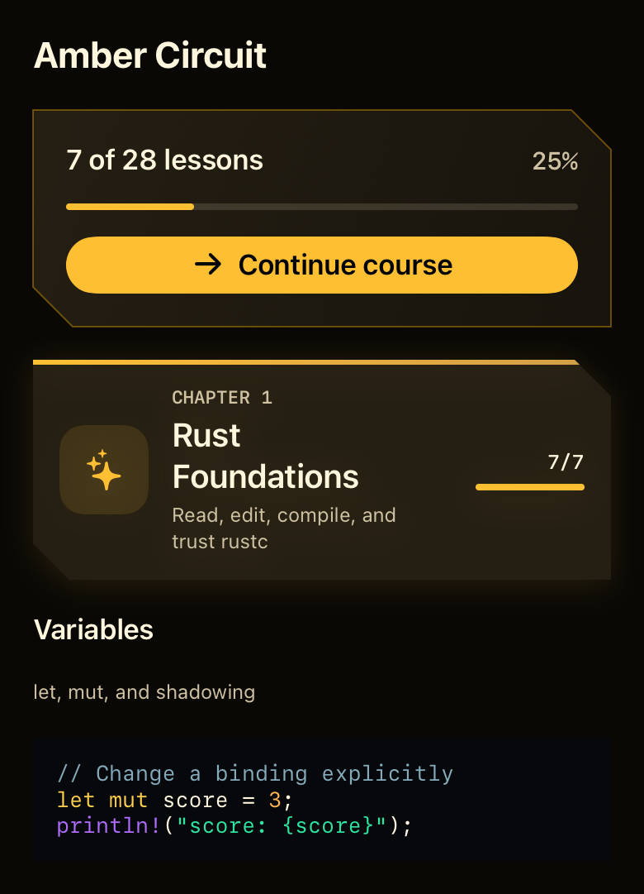
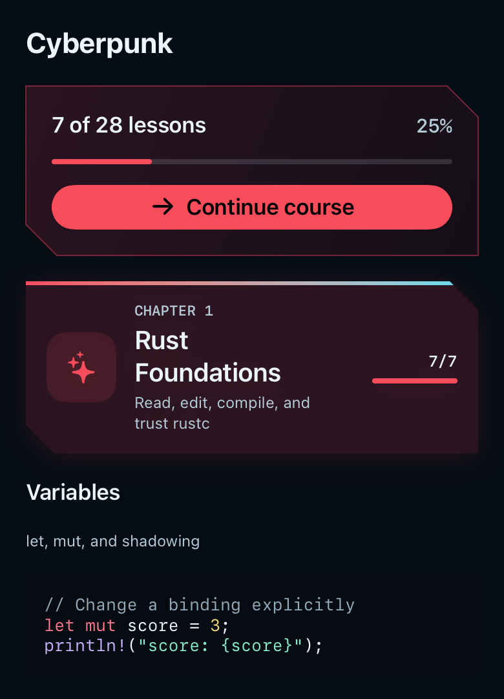
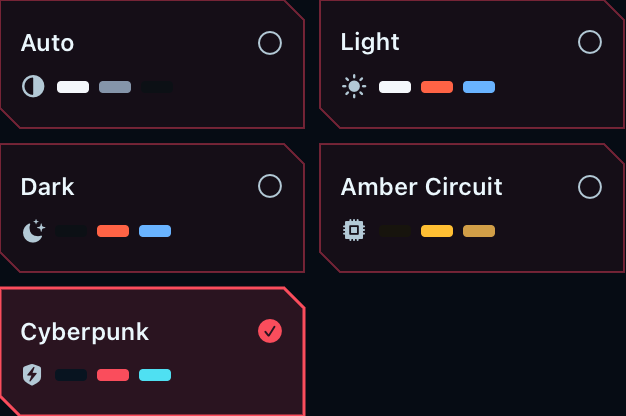
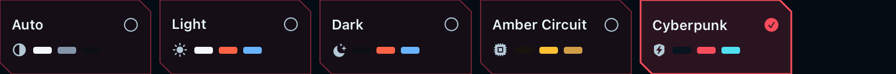

# Amber Circuit and Cyberpunk

These are renders of the app's actual SwiftUI components, produced by
`AppearanceRenderingTests`. They are component previews rather than full
device screenshots or App Store screenshot replacements.

| Amber Circuit | Cyberpunk |
| --- | --- |
| Graphite, warm gold, bronze and ivory text | Midnight blue, burgundy panels, red controls and cyan accents |
|  |  |

[Large Text rendering](theme-picker-large-text.png) verifies that accessibility
sizes can grow vertically, with full theme names and native button semantics.

## Behavior and verification

- The previous saved `cyberpunk` setting remains the gold palette and is now
  titled **Amber Circuit**. The new **Cyberpunk** choice has a separate stored
  identifier, so existing users keep their selected appearance after updating.
- Chapter banners use opaque readable surfaces, with color in their icon,
  edge and progress line. Bright primary actions use dark ink. Locked lesson
  descriptions use the normal muted text token instead of reduced opacity.
- Course actions, progress, quick checks, practice and earned badges use their
  surface's text color. Both custom themes have their own syntax palette.
- The picker caps normal card width at 152 points and content at 680 points.
  All five choices fit in one row at an iPad content width; phone widths wrap.
  Accessibility text switches to wider cards and allows additional height.
- **20 tests passed, 0 failed, 0 skipped**, using the optimized app with Xcode
  27.1 RC / SDK 27.1 on an iPhone 17 Pro simulator running iOS 26.5. This includes
  contrast, preference preservation, picker rendering at 240/313/770 points,
  Large Text, lesson-map geometry and terminal keyboard regression tests.
- Primary text exceeds 7:1 on theme surfaces, muted/inline code and primary
  action text exceed 4.5:1, and large lesson-node icons exceed 3:1. The former
  white-on-gold label is retained as a failing contrast control in the tests.

Result bundle: `build/compiler-optimization-20261024/appearance-20261026-qualified.xcresult`.
Component previews were visually inspected. Full device UI inspection remains
unavailable while the Mac is locked; no physical iPhone or Duo posture check
is claimed. Workspace/fold geometry, compiler settings and offline execution
capabilities are unchanged.

## Delivery

Build **1.1.2 (96)** was archived successfully in Xcode Cloud and is
**IN_BETA_TESTING** in TestFlight Internal QA. App Store Connect selects build
96 for the replacement submission, currently **WAITING_FOR_REVIEW**, with
manual release. The description, release notes, reviewer notes and What to
Test matched a fresh Apple readback. All 19 existing Store screenshots are
complete, with Code first; these component previews do not replace them.
[Delivery evidence](../../app-store/release-1.1.2-build96.json).
