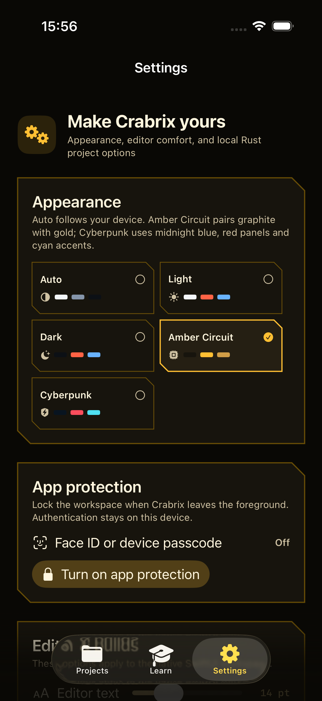
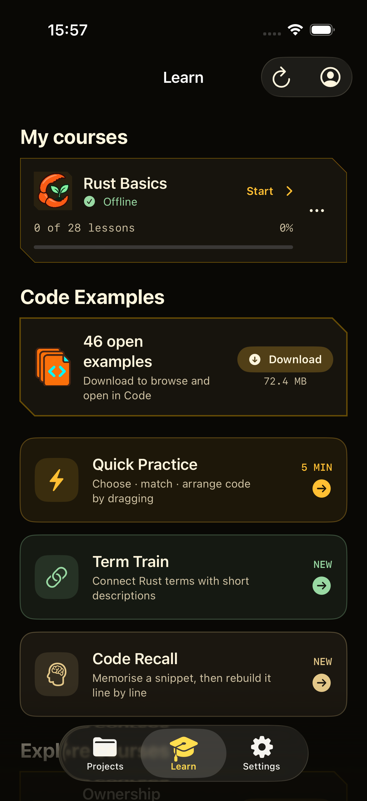
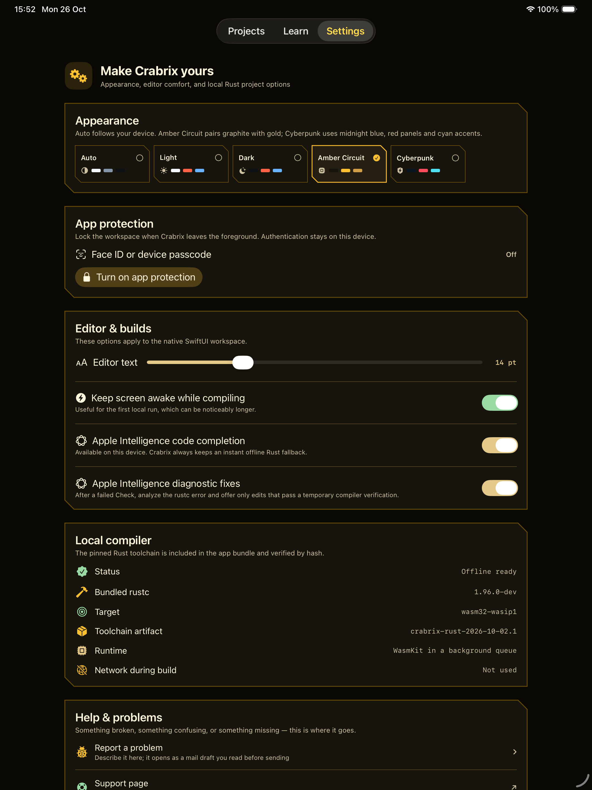
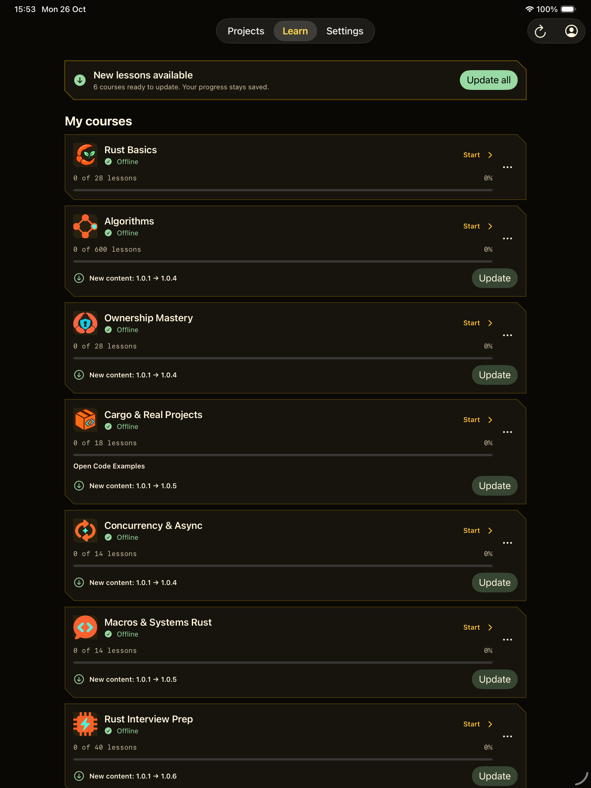
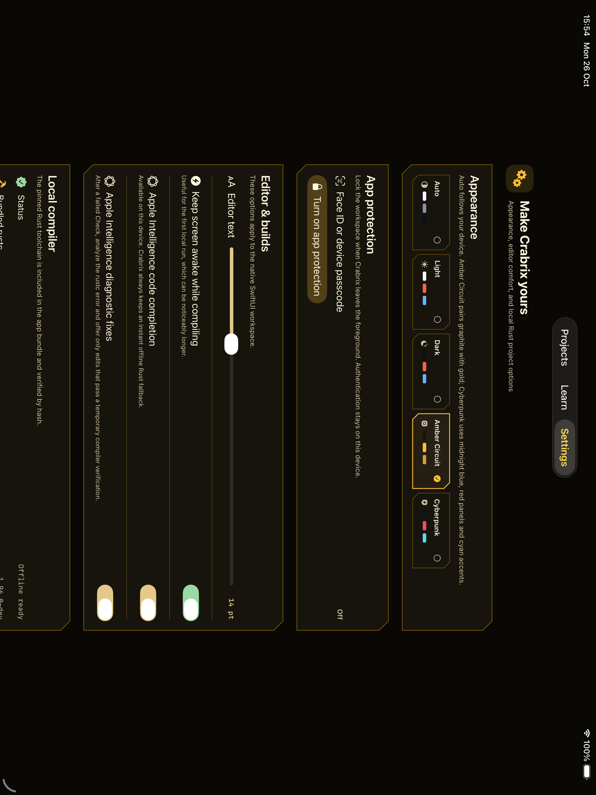
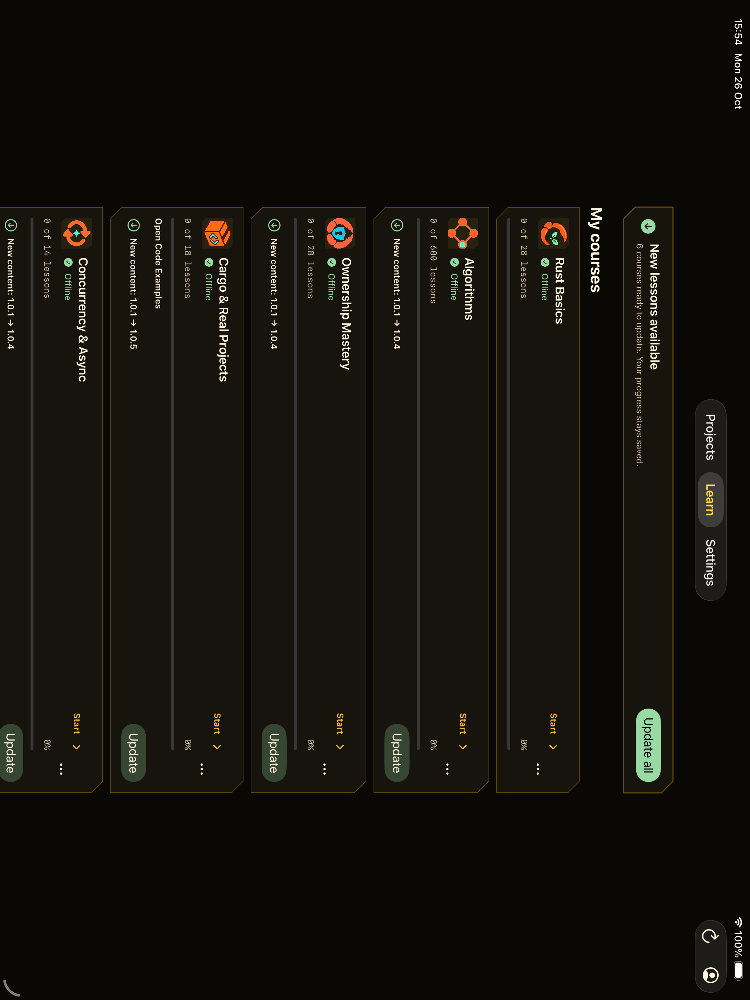

# Settings, Learn and iPad reading layout

Settings and the Learn library now share a **22-point horizontal inset** and
an **850-point centered page limit**, including the insets. Settings sections
fill that column. On iPad, practice cards use an equal-column grid inside it.

Lessons retain their **760-point reading column**. Their progress header and
bottom navigation now align with the text instead of stretching to the iPad's
edges. Quick Practice's header follows its content width too. The editor,
keyboard dock and Duo hinge calculations are unchanged.

## Native UI verification

Two UI test jobs passed on iOS 26.5 with SDK 27.1:

| Configuration | Settings/Learn edges | Reading header/footer |
| --- | --- | --- |
| iPhone, portrait, 402 × 874 points | Match within one point of native accessibility rounding | Aligned and reachable |
| iPad 13-inch, portrait, 1032 × 1376 points | Match | Aligned and reachable |
| iPad 13-inch, landscape, 1376 × 1032 points | Match | Aligned and reachable |

The checks open Settings, Learn, practice cards, the course map and the lesson;
scroll to the lesson's final action; and rotate the iPad. Current Rust Basics
content is installed or updated through the real signed-pack interface.
The iPhone also exercises the first-install Download flow. No learner state
is fabricated or reset. Native screenshots were visually inspected.

The iPad card bounds, including their stroke, are 807.5 points wide in both
orientations. Phone accessibility bounds differ by less than half a point
because of border/pixel rounding; the layout insets are shared.

These are authentic Simulator screenshots for QA, not replacement Store
assets. Physical iPhone and Duo posture verification is not claimed.

Result bundles:

- `build/layout-20261026/ipad-layout-r4.xcresult`
- `build/layout-20261026/iphone-layout-r2.xcresult`

## iPhone

| Settings | Learn |
| --- | --- |
|  |  |

## iPad

| Settings, portrait | Learn, portrait |
| --- | --- |
|  |  |

| Settings, landscape | Learn, landscape |
| --- | --- |
|  |  |

[Lesson reading](layout-ipad-portrait-lesson.png) and
[landscape lesson footer](layout-ipad-landscape-lesson-footer.png).

## Delivery

Build **1.1.2 (99)** is VALID and IN_BETA_TESTING in TestFlight Internal QA.
App Store Connect selects build 99 in the replacement submission, currently
WAITING_FOR_REVIEW. Release remains manual. The manual Xcode Cloud build and
archive succeeded; description, release/reviewer notes and TestFlight notes
matched a fresh Apple readback. All 19 existing Store screenshots are complete,
with Code first.

The delivered source commit contains the QA documentation and first-install
test setup added after the production layout commit. The application sources
are identical to those used in the passing native UI checks.
[Delivery evidence](../../app-store/release-1.1.2-build99.json).
